### Olá 👋

<table>
<td>
  
I'm João, an astrophysicist searching for exoplanets.  
That's right, these 🌍 and these 🪐, but around other stars.

⬅️ I look more or less like that  
👨‍💻 In coding mode, I write mostly Python and C++  

</td>
<td>

  <a href="https://github.com/StevenBtw/gitbonsai">
  <picture>
    <source media="(prefers-color-scheme: dark)" srcset="assets/bonsai-dark.svg" />
    
  </picture>
  </a>

</td>
</table>

Checkout some of my projects below

